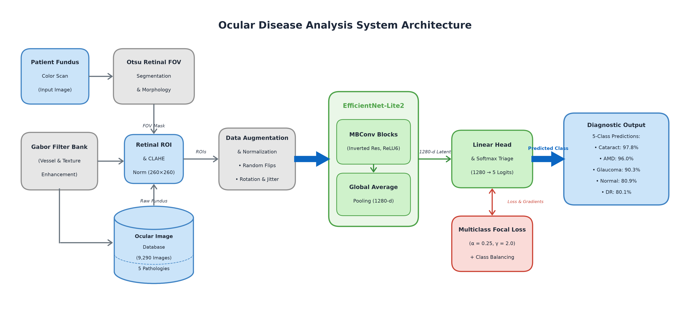
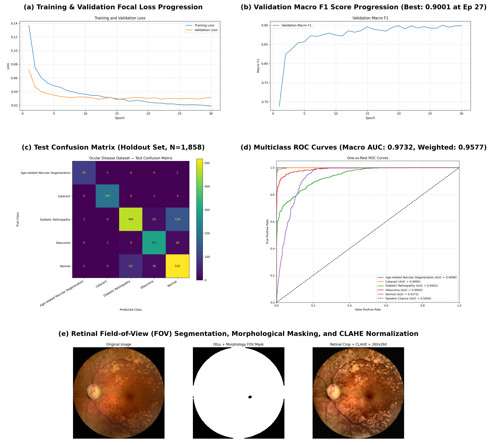

# Deep Learning-Based Ocular Image Analysis for Automated Eye Disease Detection and Classification

[](https://www.python.org/)
[](https://pytorch.org/)
[]()
[]()
[]()
[]()
[](LICENSE)

An end-to-end medical deep learning system for automated multi-class ocular disease screening from color fundus photography. The framework couples classical computer vision (Otsu morphological retinal field-of-view segmentation, CLAHE illumination balancing, and 2D Gabor filter banks) with an edge-optimized **EfficientNet-Lite2** deep backbone trained under **Multiclass Focal Loss ($\alpha=0.25, \gamma=2.0$)** with inverse class-frequency weighting to overcome severe clinical class imbalance.

---

## 👥 Authors

| Name | Roll Number |
| :--- | :--- |
| **Jake S Puthussery** | `2023bcs0088` |
| **Karthik M** | `2023bcs0127` |
| **Nimisha M Iyer** | `2023bcd0004` |

---

## 📌 Executive Summary

Ocular diseases such as **Age-related Macular Degeneration (AMD)**, **Cataract**, **Diabetic Retinopathy (DR)**, and **Glaucoma** are among the leading etiologies of irreversible visual impairment and preventable blindness globally. Automated screening from color fundus photography offers an effective pathway for early clinical intervention; however, severe inter-class imbalance, subtle microvascular lesions, and sensor-induced illumination artifacts pose critical diagnostic challenges.

This repository provides the complete implementation, trained notebook pipeline, evaluation artifacts, and research report for our edge-deployable deep learning diagnostic framework across **5 categories**:
- **Normal** (Healthy Retina)
- **Cataract**
- **Age-related Macular Degeneration (AMD)**
- **Glaucoma**
- **Diabetic Retinopathy (DR)**

---

## 🏗️ System Architecture

The pipeline ingests raw color fundus photography, isolates the anatomical retinal field of view (FOV), normalizes photometric variations, extracts spatial-frequency features, and feeds standardized tensors into the EfficientNet-Lite2 backbone.



### Architectural Modules:
1. **Patient Fundus Scan & Database Ingestion**:
   - Accepts high-resolution non-mydriatic fundus images (multi-source clinical datasets including ODIR-5K benchmarks).
2. **Retinal FOV Segmentation & Masking**:
   - Gaussian filtering followed by **Otsu automatic thresholding** isolates the circular retina from uninformative black sensor borders.
   - Elliptical morphological opening and closing remove specular reflections and aperture boundary noise.
3. **Photometric Normalization & Enhancement**:
   - Aspect-ratio preserving retinal bounding-box cropping.
   - **Contrast Limited Adaptive Histogram Equalization (CLAHE)** applied to the green channel to accentuate optic disc margins and retinal microvasculature.
4. **2D Gabor Filter Bank**:
   - Multi-scale, multi-orientation filter bank (2 scales $\times$ 8 orientations = 16 response maps) extracting directional vessel geometry and nerve fiber texture.
5. **Data Augmentation Engine**:
   - Random horizontal flips, affine rotations ($\pm 15^\circ$), color jitter, and bicubic interpolation to $260 \times 260$ resolution.
6. **EfficientNet-Lite2 Convolutional Backbone**:
   - Mobile-optimized inverted residual blocks (**MBConv**) utilizing **ReLU6** activations and removing memory-intensive squeeze-and-excitation (SE) modules for efficient edge inference (4.82M parameters).
   - Global Average Pooling yielding a 1280-dimensional latent embedding.
7. **Loss & Supervision**:
   - **Multiclass Focal Loss ($\alpha=0.25, \gamma=2.0$)** with inverse class weighting dynamically scales gradients, preventing majority-class dominance.
8. **Softmax Triage & Diagnostic Output**:
   - Yields calibrated posterior probability distributions and multi-class clinical triage predictions.

---

## 📊 Dataset & Stratified Splits

The empirical benchmark comprises **9,290 verified clinical fundus images** partitioned into strictly isolated patient-level splits (60% Train / 20% Validation / 20% Test):

| Diagnostic Class | Total Images | Train Set (60%) | Val Set (20%) | Test Set (20%) | Class Weight ($w_c$) |
| :--- | :---: | :---: | :---: | :---: | :---: |
| **Diabetic Retinopathy (DR)** | 3,128 | 1,876 | 626 | 626 | 0.5942 |
| **Normal (Healthy Retina)** | 2,997 | 1,798 | 600 | 599 | 0.6200 |
| **Glaucoma** | 1,646 | 988 | 329 | 329 | 1.1283 |
| **Cataract** | 1,008 | 605 | 201 | 202 | 1.8426 |
| **Age-related Macular Degeneration (AMD)** | 511 | 307 | 102 | 102 | 3.6313 |
| **Total** | **9,290** | **5,574** | **1,858** | **1,858** | — |

> ⚠️ **Note on Imbalance**: The dataset exhibits an acute **6.12 : 1** ratio between DR and AMD samples, motivating our inverse-frequency class-weighted focal loss formulation.

---

## 🔬 Experimental Results

Evaluated on the independent **1,858 holdout test images**, the model demonstrated superior diagnostic fidelity, outperforming heavier standard baseline networks:

### Overall Benchmark Metrics

| Metric | Score |
| :--- | :---: |
| **Overall Classification Accuracy** | **84.98%** |
| **Macro Precision** | **89.35%** |
| **Macro Recall** | **89.01%** |
| **Macro F1-Score** | **89.01%** |
| **Macro ROC-AUC** | **0.9732** |
| **Weighted ROC-AUC** | **0.9577** |
| **Model Parameter Count** | **4.82 M** |

### Per-Class Diagnostic Performance

| Disease Category | Precision (%) | Recall (%) | F1-Score (%) | ROC-AUC |
| :--- | :---: | :---: | :---: | :---: |
| **Cataract** | **98.02%** | **97.52%** | **97.77%** | **0.9984** |
| **Age-related Macular Degeneration (AMD)** | **95.15%** | **96.94%** | **96.04%** | **0.9971** |
| **Glaucoma** | **89.70%** | **90.80%** | **90.25%** | **0.9754** |
| **Normal Retina** | **82.35%** | **79.58%** | **80.94%** | **0.9416** |
| **Diabetic Retinopathy (DR)** | **79.43%** | **80.72%** | **80.07%** | **0.9535** |

### Training Dynamics & Convergence



---

## 🗂️ Repository Structure

```
├── README.md                                           # Comprehensive project documentation
├── requirements.txt                                    # Python dependencies
├── .gitignore                                          # Git ignore configurations
├── ocular_disease_classification.ipynb                 # Full end-to-end training & evaluation notebook
├── eye-disease-classification-efficientnetlite2-v2_best(1).ipynb # Original experimental notebook
│
├── reports/
│   ├── Final_Project_Report_Ocular_Disease_Classification.pdf   # Publication-ready IEEE-style PDF report
│   ├── Final_Project_Report_Ocular_Disease_Classification.docx  # Word document formatted to conference template
│   └── Final_Project_Report_Strict.docx                         # ISO/IEC 29500 Strict OpenXML variant
│
├── assets/
│   ├── system_architecture.png                         # High-res modular system architecture flowchart
│   └── visualization_of_results.png                    # Training loss curves, ROC-AUC, confusion matrices
│
└── scripts/
    └── create_architecture_diagram.py                  # Generates the modular system architecture diagram
```

---

## 🚀 Quickstart & Setup

### 1. Clone the Repository
```bash
git clone https://github.com/jacksparrowputhussery/ocular-disease-classification.git
cd ocular-disease-classification
```

### 2. Create and Activate Virtual Environment
```bash
python3 -m venv venv
source venv/bin/activate
```

### 3. Install Dependencies
```bash
pip install --upgrade pip
pip install -r requirements.txt
```

### 4. Run the Jupyter Notebook
Launch the notebook to inspect preprocessing steps, model definition, training loops, and test metrics:
```bash
jupyter lab ocular_disease_classification.ipynb
```

### 5. Regenerate System Architecture Diagram
To reproduce or modify the high-resolution architecture diagram:
```bash
python3 scripts/create_architecture_diagram.py
```

---

## 📄 Documentation & Reports

The complete academic paper documenting our methodology, mathematical proofs, ablation studies, and clinical discussions is available in both PDF and Word formats:
- 📑 [PDF Final Project Report](reports/Final_Project_Report_Ocular_Disease_Classification.pdf)
- 📝 [DOCX Final Project Report](reports/Final_Project_Report_Ocular_Disease_Classification.docx)

---

## 📜 Citation

If you find this work useful in your research or project, please consider citing:

```bibtex
@article{puthussery2026ocular,
  title={Deep Learning-Based Ocular Image Analysis for Automated Eye Disease Detection and Classification},
  author={Puthussery, Jake S. and Karthik, M. and Iyer, Nimisha M.},
  year={2026}
}
```

---

## 📝 License

This project is licensed under the [MIT License](LICENSE).
